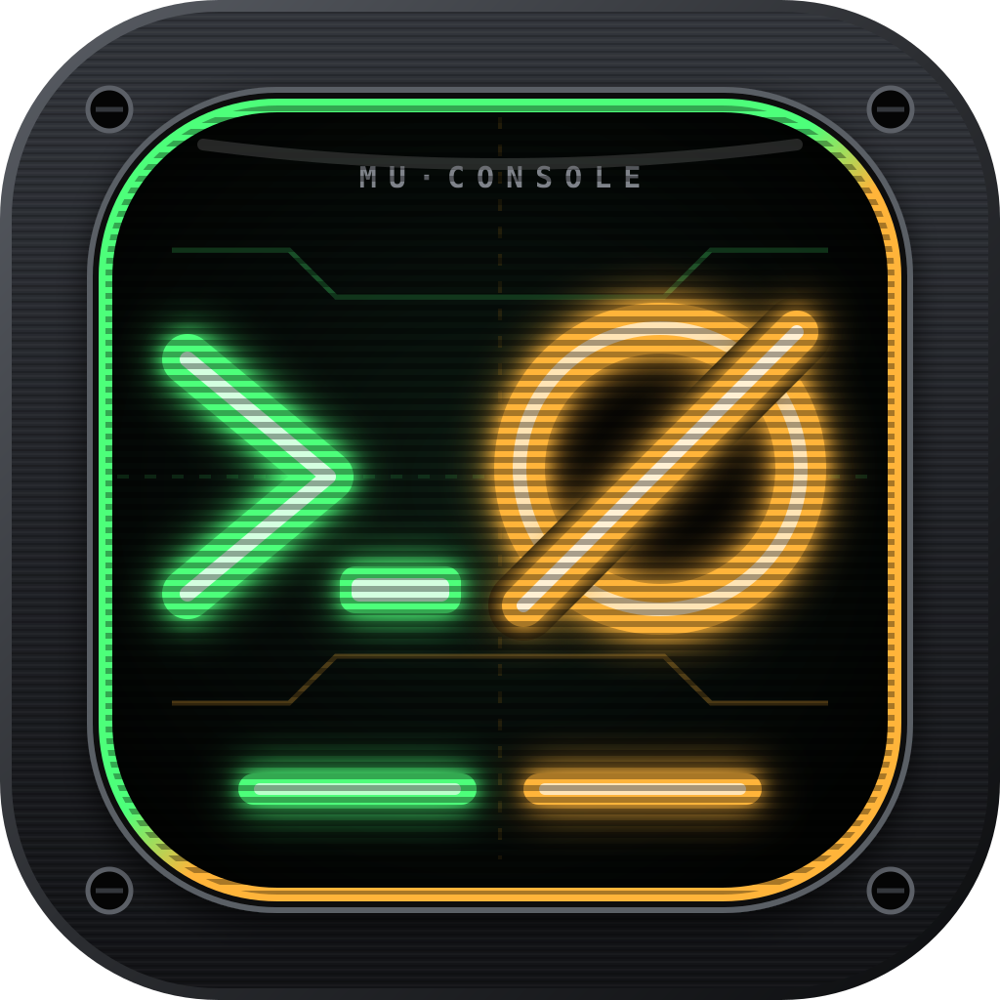

# LMA1980

  

  
  
  
  

______________________________________________________________________

Welcome to the project portal for open-source systems, native RISC-V solutions, and software incubators.

## Mu-Console, Mu-CI & Platform Ecosystem

  <a href="https://github.com/LMA1980/mu-console">
    _∅ P1+P3)" width="160"/>
  </a>

  
  
  
  

Modular, Rust-native CI/CD control plane, zero-trust authorization core, artifact registry, and dual-skin WebAssembly operator console engineered for heterogeneous `x86_64`, `aarch64`, and bare-metal RISC-V (SpacemiT Key Stone K3) environments.

- [**`mu-console`**](https://github.com/LMA1980/mu-console) — Unified CI/CD and cluster **Void Console** (*Mu* / `무` / `無` = Void / Null) spanning 8 capability-gated areas (`system`, `ci`, `cd`, `ab_deploy`, `repository`, `observability`, `model_runner`, `platform`) with `HtmlCoreSkin` (default) and `WireframeSkin` (opt-in). Driven by dual WebAssembly modules ([`mu-console-ui`](https://github.com/LMA1980/mu-console-ui) on the main thread and [`mu-console-data`](https://github.com/LMA1980/mu-console-data) in a dedicated Web Worker) exchanging versioned `postcard` frames via [`mu-console-protocol`](https://github.com/LMA1980/mu-console-protocol), styled with [`mu-console-theme`](https://github.com/LMA1980/mu-console-theme) and [`mu-console-layout`](https://github.com/LMA1980/mu-console-layout). Vector and logo assets (`>_∅` Void Prompt, P1+P3) are published in [`assets/logos/`](assets/logos/).
- [**`mu-auth`**](https://github.com/LMA1980/mu-auth) — `#![no_std]` + `alloc` (`#![forbid(unsafe_code)]`) policy, composable folio DAG, independent role-lease, and optional `github-oauth` / WebAuthn Passkey verification core shared across the platform.
- [**`mu-ci`**](https://github.com/LMA1980/mu-ci) — Declarative CI orchestration suite:
  - [**`mu-ci-controller`**](https://github.com/LMA1980/mu-ci-controller) — GitHub webhook ingestion, coalescing FIFO job queue, pipeline quality scoring (`cargo llvm-cov`, `cargo clippy`, `cargo audit`, benchmarks), `/api/auth/*` authority, and dynamic SVG scorecards.
  - [**`mu-ci-worker`**](https://github.com/LMA1980/mu-ci-worker) — WebSocket stage execution agent supporting automated workspace sync, distributed `sccache` caching (`SccacheMode::Try` / `Mandatory`), and sandboxed stage execution.
  - [**`mu-ci-ipc`**](https://github.com/LMA1980/mu-ci-ipc) — Shared WebSocket and IPC frame definitions connecting controller and workers.
  - [**`mu-ci-tools`**](https://github.com/LMA1980/mu-ci-tools) — Compile-time `ToolAdapter` registry including Rust toolchain, documentation, and `CargoDeployAdapter` tasks.
  - [**`mu-ci-isolation`**](https://github.com/LMA1980/mu-ci-isolation) — Dual-backend monotonic sandboxing engine (`KernelSandbox` via Landlock/`cgroupv2`/seccomp and `HypervisorSandbox` via KVM microVMs).
  - [**`mu-ci-web`**](https://github.com/LMA1980/mu-ci-web) — Leptos (CSR) WebAssembly queue monitor and job drill-down dashboard.
- [**`mu-cd`**](https://github.com/LMA1980/mu-cd) — Continuous delivery A/B deployment suite:
  - [**`mu-cd-controller`**](https://github.com/LMA1980/mu-cd-controller) — `CdAuthorizer`-gated release promotion, canary coordination, and cluster lease orchestration.
  - [**`mu-cd-agent`**](https://github.com/LMA1980/mu-cd-agent) — Node deployment agent executing Btrfs `@a`/`@b` subvolume snapshots, atomic swaps, health watchdogs, and sub-second rollbacks.
  - [**`mu-cd-ipc`**](https://github.com/LMA1980/mu-cd-ipc) — Continuous delivery IPC protocol and contract types.
- [**`mu-registry`**](https://github.com/LMA1980/mu-registry) — Content-addressed SHA-256 artifact store, DuckDB metadata catalog, Cargo Sparse HTTP registry front-end, and canary integration test bundle API.

## Jero AI Runtime Solution

Distributed AI inference runtime and control plane engineered specifically for the SpacemiT Key Stone K3 SoC (16 heterogeneous RISC-V cores across general-purpose and vector/matrix clusters, 32 GB unified memory). Built around cycle-exclusive execution, systemd cgroup isolation, and hardware-accelerated RVV 1.0 / IME compute kernels.

Public repositories composing the solution:

- [**`jero-core`**](https://github.com/LMA1980/jero-core) — Foundational core abstractions, quantization types (`QuantType`), zero-copy tensor views (`TensorView`), single-prompt execution contexts, and structured platform diagnostics (`K3Error`).
- [**`jero-kernels-rvv`**](https://github.com/LMA1980/jero-kernels-rvv) — Low-level RISC-V Vector (RVV 1.0) and SpacemiT K3 A100 `XSMTVDotII` IME (`smt.vpack.vv` / `smt.vmadot`) matrix acceleration kernels.
- [**`jero-tokenizer`**](https://github.com/LMA1980/jero-tokenizer) — Tokenizer abstractions with deterministic fallback token handling for automated prompt evaluation.
- [**`jero-kv-cache`**](https://github.com/LMA1980/jero-kv-cache) — Policy-free context memory holder daemon managing bounded `mlock` shared-memory arenas and passing arena file descriptors over Unix Domain Sockets (`SCM_RIGHTS`) to survive worker restarts.
- [**`jero-engine`**](https://github.com/LMA1980/jero-engine) — Compute runtime executing tensor graphs, thread-group synchronization, and paged KV cache allocation over `jero-kernels-rvv` and `jero-kv-cache`.
- [**`jero-manager`**](https://github.com/LMA1980/jero-manager) — Orchestration daemon and control plane handling session state and content-addressed model catalogs in DuckDB, IPC serialization over Unix Domain Sockets + shared memory, modular OpenAI/Anthropic compatible APIs, `mu-auth` policy gating (`/api/mr/v1/*`), and `mu-observable-ipc` telemetry emission.
- [**`jero-arch-synthetic`**](https://github.com/LMA1980/jero-arch-synthetic) — Synthetic transformer architecture fixture for deterministic kernel, KV-cache, and integration verification.
- [**`jero-arch-llama`**](https://github.com/LMA1980/jero-arch-llama) — Llama family model architecture implementation.
- [**`jero-arch-mistral`**](https://github.com/LMA1980/jero-arch-mistral) — Mistral family model architecture implementation.
- [**`jero-arch-phi3`**](https://github.com/LMA1980/jero-arch-phi3) — Phi-3 family model architecture implementation.
- [**`jero-arch-bitnet`**](https://github.com/LMA1980/jero-arch-bitnet) — BitNet ternary/1.58-bit quantized model architecture implementation.
- [**`jero-arch-dory`**](https://github.com/LMA1980/jero-arch-dory) — Dory model architecture implementation.

### Documentation Portal

Complete architectural, developer, and operator documentation for the Jero / Model-Runner ecosystem is published in the portal:

- [**Model Runner Documentation Portal**](model-runner/) — Comprehensive portal landing page.
- [**Public Open-Source AI Benchmark Leaderboard (`BenchLM` / `DeepEval` / `lm-eval`)**](model-runner/benchmarks.md) — Five-pillar capability leaderboard (`MMLU-Pro`, `GSM8K`, `HumanEval`, `IFEval`, `TruthfulQA`), `FP16` vs quantized fidelity deltas, and `X100` vs `A100` IME runtime efficiency scorecards.
- **End-User Guides**: [Quickstart Guide](model-runner/quickstart.md) | [Full Reference Manual](model-runner/manual.md)
- **Operator Runbooks**: [Deployment & Maintenance Guide](model-runner/deployment.md) | [Troubleshooting Guide](model-runner/troubleshooting.md) | [Hardware Tuning Guide](model-runner/tuning.md)
- **Architecture & API**: [Crate Reference Guides](model-runner/docs/crates/) | [Rustdoc API Reference](model-runner/api/)

______________________________________________________________________

## Jero-Mu Platform Architecture & Milestone 2 Guides

Comprehensive architectural specifications, security models, and developer guides for the Milestone 2 (*Declarative Configuration, Isolation & Continuous Delivery*) platform:

- [**Jero-Mu Milestone 2 Documentation Portal**](content/docs/index.md) — Central portal landing page and architectural index.
- [**Declarative `mu-ci` (`.muci/mu-ci.yml` / `ActionRunner.yml`) Syntax Reference**](content/docs/actionrunner-syntax.md) — Complete 3-tier pipeline schema (`tasks`, `stages`, `on_action`), compile-time `ToolAdapter` registry (`mu-ci-tools`), distributed `sccache` compiler caching policy reference, DAG cycle detection, and 3-phase configuration migration.
- [**Operator & Workflow Guide: Distributed `sccache` Compilation Caching**](content/docs/sccache-guide.md) — End-to-end operator guide covering how `sccache` influences build timings (cold vs. warm runs), `CARGO_INCREMENTAL=0` trade-offs, cross-node toolchain/architecture cache sharing, `x86_64` and `riscv64` installation, Local Disk vs. S3/Garage/MinIO backend setup, and verification walkthroughs.
- [**`mu-ci-isolation` (`MuIsolation`) Dual-Backend Sandbox Model**](content/docs/isolation-model.md) — 3-layer monotonic privilege attenuation ($\\text{Ceiling} \\cap \\text{Desired} \\cap \\text{Task}$), fail-closed `SecurityGrantDenied`, Landlock/cgroupv2/seccomp `KernelSandbox`, and KVM microVM `HypervisorSandbox`.
- [**`mu-registry` (`MuRegist`) Cargo Sparse Registry Guide**](content/docs/muregist-guide.md) — Cargo Sparse HTTP Index protocol, SHA-256 CAS, DuckDB metadata catalog, and canary release promotion API with `step-ca` mTLS authentication.
- [**`mu-cd` (`MuConDe`) Continuous Delivery A/B Deployment Guide**](content/docs/muconde-guide.md) — Declarative `.mucd/MuConDe.yml` / `.muconde/MuConDe.yml` contracts, idle cluster lease negotiation, Btrfs `@a`/`@b` subvolume snapshots, atomic symlink swaps, post-swap health watchdog, and sub-second rollback.

______________________________________________________________________

## Mu-Observable Distributed Observability & Antigravity MCP

Distributed OpenTelemetry collection, 3-tier DuckDB/Parquet telemetry lake, hardware-stratified regression analytics, and native Antigravity AI Model Context Protocol (MCP) server ([`mu-observable`](https://github.com/LMA1980/mu-observable)):

- [**`mu-observable-hub`**](https://github.com/LMA1980/mu-observable-hub) ([Crate Architecture Guide](model-runner/docs/crates/muobserve.md)) — Centralized ingestion server with zero-trust `step-ca` mTLS SAN identity binding, `MuAuthFolioVerifier` policy gating, 3-tier storage architecture (7-day `hot.duckdb` + Hive-partitioned cold Zstd Parquet + unified `v_*` views), hardware-stratified regression engine isolating X100 ($VLEN=256$) from A100 ($VLEN=1024$), rolling 30-day test flakiness scoring, and Antigravity MCP server with **12** analytical tools.
- [**`mu-observable-collector`**](https://github.com/LMA1980/mu-observable-collector) ([Architecture Guide](model-runner/docs/crates/muobserve-collector.md)) — Sandboxed edge telemetry collector daemon supporting loopback OTLP HTTP (`/v1/traces`, `/v1/metrics`, `/v1/logs`) and native `MUOB` Arrow IPC streams, streaming zero-ReDoS secret redaction, bounded 256 MiB ring-buffer WAL with 3-tier priority eviction, and `mu-ci-isolation` `KernelSandbox` confinement.
- [**`mu-observable-sentinel`**](https://github.com/LMA1980/mu-observable-sentinel) — Edge SLO monitoring and anomaly detection sentinel tracking canary health, host metrics, and threshold alerts across cluster nodes.
- [**`mu-observable-ipc`**](https://github.com/LMA1980/mu-observable-ipc) ([Wire & Schema Reference](model-runner/docs/crates/muobserve-ipc.md)) — Zero-copy 24-byte `IpcHeader` wire framing (`*b"MUOB"`), Apache Arrow columnar schemas for logs, spans, metrics, test runs, and benchmarks, W3C `traceparent` context propagation, and Apache Fory RPC control envelopes.

______________________________________________________________________

## Incubator Projects

Documentation for incubator projects and early-stage prototypes.

### Jero-Mu (제로 무)

An incubator project for a distributed application model, I will attempt to write it in Rust or in C#, and any other appropriate language to work with this solution.

#### api.jelomu.local

A Rocket (v0.6-dev) integration to provide a distributable WebAPI.

- /about
  - Provides runtime information on the current runtime.
- Still a work in progress

The goal will be to support both public and mTLS authenticated requests. [planned]

- The idea is to provide the end-users the guide-lines to generate CSR for gaining access.
- Document the steps required by the operator to support mTLS server-side.
- Establish usage policy.
- Still require to authenticate the client user with either
  - Username / Password or Passphrase
  - Short lived Token

Provide an authentication mechanism [planned]

- Use the host own public key to encrypt the password: forcing decryption by the host private key.
- Use a username@realm-identifier
- Return default role along with an associated session-token: minimal-authorized-access

Provide an authorization mechanism [planned]

- A given user may have access to one or many role
- minimal-authorized-access provides the following policy
  - get-about
  - get-about-detailed
  - ...
- anonymous-access provides the following policy (applies to tokenless requests)
  - get-about
  - ...

#### neuron-rs (neuron)

A minimal distributed compute unit: the idea is to be able to support links to resources. No transport involved at this level.

[milestone-1](neuron-rs/milestone-1.md)

#### neuron-runner-rs (neuron-runner)[planned]

A minimal runtime environment for neurons implementation. Transport layer to be determined.

### [workspace-builder](https://github.com/LMA1980/workspace-builder)

A tool to help compile multiple ABI targets when building a cargo project.
