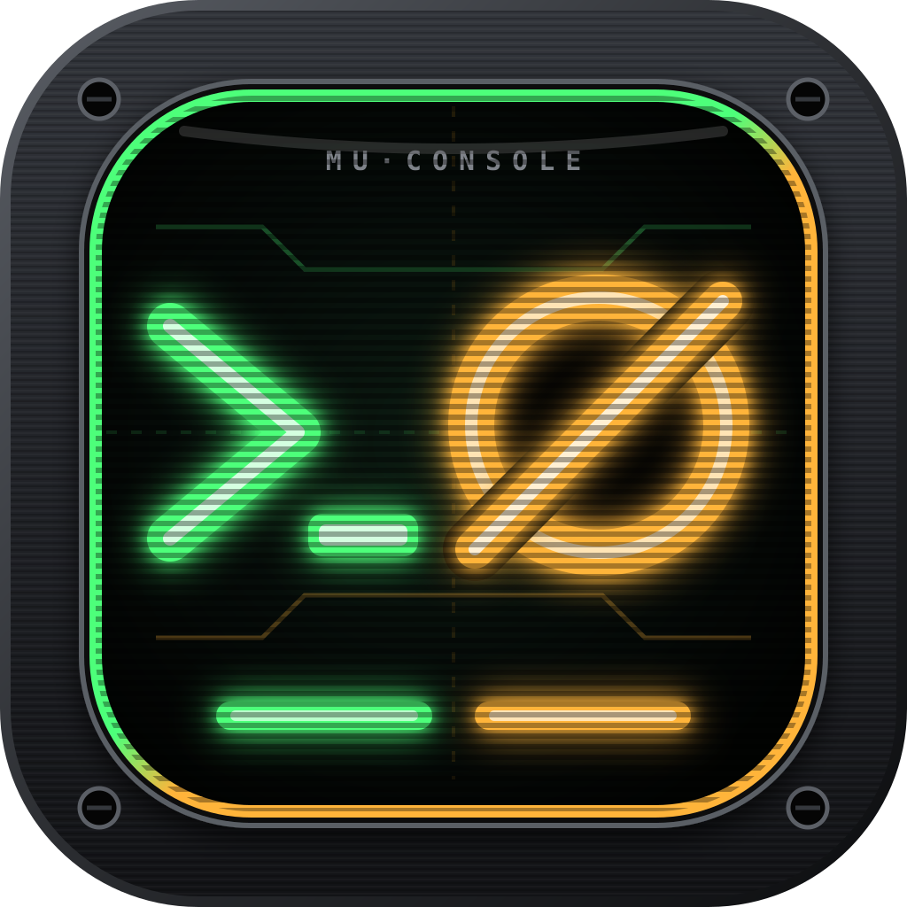

# LMA1980

  

  
  
  
  

______________________________________________________________________

Welcome to the project portal for open-source systems, native RISC-V solutions, and software incubators.

## ActionRunner & MuConsole Solution

  <a href="https://github.com/LMA1980/MuConsole">
    _∅ P1+P3)" width="160"/>
  </a>

  
  
  
  

Lightweight, native GitHub Webhook CI execution sidecar, continuous delivery orchestrator, and real-time **"Avionics Terminal"** observability suite designed for bare-metal RISC-V hardware (SpacemiT Key Stone K3). It serializes builds with event coalescing, executes automated test and hygiene pipelines, calculates factory quality scores, and serves dynamic SVG status cards.

- [**MuConsole**](https://github.com/LMA1980/MuConsole) — Unified CI/CD **Void Console** (*Mu* / `무` / `無` = Void / Null) for **ActionRunner** (continuous integration, P1 green phosphor `#4dff7a`) and **MuConDe** (continuous delivery, P3 amber phosphor `#ffb43a`). Built as a zero-scroll, SVG-first "Avionics Terminal" UI driven by two WebAssembly modules (`muconsole-ui` on the main thread and `muconsole-data` in a dedicated Web Worker communicating via versioned `postcard` frames in `muconsole-protocol`, styled by `muconsole-theme` and `muconsole-layout`). Official vector and GitHub App logo assets (`>_∅` Void Prompt, P1+P3) are published in [`assets/logos/`](assets/logos/).
- [**ActionRunner-rs**](https://github.com/LMA1980/ActionRunner-rs) — High-performance GitHub Webhook daemon and CI execution sidecar written in Rust. Features coalescing FIFO queues, HMAC-SHA256 signature verification, automated workspace synchronization, distributed `sccache` compilation caching with S3/Garage hijack auto-recovery (`SccacheMode::Try` / `Mandatory`), pipeline quality scoring (`cargo llvm-cov`, `cargo clippy`, `cargo audit`, benchmarks), and dynamic SVG status cards.
- [**ActionRunner-web**](https://github.com/LMA1980/ActionRunner-web) — WebAssembly queue monitor and job drill-down dashboard built with Leptos (CSR). Provides real-time build status, individual submodule scorecards, and step-by-step CI execution logs.

## Model Runner Solution

High-performance, distributed AI inference runtime and control plane engineered specifically for the SpacemiT Key Stone K3 SoC (16 heterogeneous RISC-V cores across general-purpose and vector/matrix clusters, 32 GB unified memory). Built around cycle-exclusive execution, systemd cgroup isolation, and hardware-accelerated RVV 1.0 / IME compute kernels.

Public repositories composing the solution:

- [**k3-core**](https://github.com/LMA1980/k3-core) — Foundational core abstractions, quantization types (`QuantType`), zero-copy tensor views (`TensorView`), single-prompt execution contexts, and structured platform diagnostics (`K3Error`).
- [**k3-kv**](https://github.com/LMA1980/k3-kv) — Policy-free context memory holder daemon managing bounded `mlock` shared-memory arenas and passing arena file descriptors over Unix Domain Sockets (`SCM_RIGHTS`) to survive worker restarts.
- [**k3-engine**](https://github.com/LMA1980/k3-engine) — Low-level compute runtime implementing unified VLA RVV 1.0 vector loops, A100 IME matrix acceleration, thread-group synchronization, and paged KV cache allocation.
- [**k3-manager**](https://github.com/LMA1980/k3-manager) — Orchestration daemon and control plane handling session state and content-addressed model catalogs in DuckDB, IPC serialization over Unix Domain Sockets + shared memory, and modular OpenAI/Anthropic compatible APIs.

### Documentation Portal

Complete architectural, developer, and operator documentation for the Model-Runner ecosystem is published in the portal:

- [**Model Runner Documentation Portal**](model-runner/) — Comprehensive portal landing page.
- [**Public Open-Source AI Benchmark Leaderboard (`BenchLM` / `DeepEval` / `lm-eval`)**](model-runner/benchmarks.md) — Five-pillar capability leaderboard (`MMLU-Pro`, `GSM8K`, `HumanEval`, `IFEval`, `TruthfulQA`), `FP16` vs quantized fidelity deltas, and `X100` vs `A100` IME runtime efficiency scorecards.
- **End-User Guides**: [Quickstart Guide](model-runner/quickstart.md) | [Full Reference Manual](model-runner/manual.md)
- **Operator Runbooks**: [Deployment & Maintenance Guide](model-runner/deployment.md) | [Troubleshooting Guide](model-runner/troubleshooting.md) | [Hardware Tuning Guide](model-runner/tuning.md)
- **Architecture & API**: [Crate Reference Guides](model-runner/docs/crates/) | [Rustdoc API Reference](model-runner/api/)

______________________________________________________________________

## Jero-Mu Platform Architecture & Milestone 2 Guides

Comprehensive architectural specifications, security models, and developer guides for the Milestone 2 (*Declarative Configuration, Isolation & Continuous Delivery*) platform:

- [**Jero-Mu Milestone 2 Documentation Portal**](content/docs/index.md) — Central portal landing page and architectural index.
- [**Declarative ActionRunner.yml Syntax Reference**](content/docs/actionrunner-syntax.md) — Complete 3-tier pipeline schema (`tasks`, `stages`, `on_action`), compile-time `ToolAdapter` registry, distributed `sccache` compiler caching & operator self-service setup guide, DAG cycle detection, and 3-phase configuration migration.
- [**MuIsolation Dual-Backend Sandbox Model**](content/docs/isolation-model.md) — 3-layer monotonic privilege attenuation ($\\text{Ceiling} \\cap \\text{Desired} \\cap \\text{Task}$), fail-closed `SecurityGrantDenied`, Landlock/cgroupv2/seccomp `KernelSandbox`, and KVM microVM `HypervisorSandbox`.
- [**MuRegist Cargo Sparse Registry Guide**](content/docs/muregist-guide.md) — RFC 2789 Cargo Sparse HTTP Index protocol, SHA-256 CAS, DuckDB metadata catalog, and canary release promotion API with `step-ca` mTLS authentication.
- [**MuConDe Continuous Delivery A/B Deployment Guide**](content/docs/muconde-guide.md) — Declarative `.muconde/MuConDe.yml` contracts, idle cluster lease negotiation, Btrfs `@a`/`@b` subvolume snapshots, atomic symlink swaps, post-swap health watchdog, and sub-second rollback.

______________________________________________________________________

## MuObserve Distributed Observability & Antigravity MCP (Milestone 3)

Distributed OpenTelemetry collection, 3-tier DuckDB/Parquet telemetry lake, hardware-stratified regression analytics, and native Antigravity AI Model Context Protocol (MCP) server:

- [**MuObserve Crate Architecture Guide**](model-runner/docs/crates/muobserve.md) — Centralized ingestion server with zero-trust `step-ca` mTLS SAN identity binding, 3-tier storage architecture (7-day `hot.duckdb` + Hive-partitioned cold Zstd Parquet + unified `v_*` views), hardware-stratified regression engine isolating X100 ($VLEN=256$) from A100 ($VLEN=1024$), rolling 30-day test flakiness scoring, and Antigravity MCP server with 10 analytical tools.
- [**MuObserve-collector Architecture Guide**](model-runner/docs/crates/muobserve-collector.md) — Sandboxed edge telemetry collector daemon supporting loopback OTLP HTTP (`/v1/traces`, `/v1/metrics`, `/v1/logs`) and native `MUOB` Arrow IPC streams, streaming zero-ReDoS secret redaction, bounded 256 MiB ring-buffer WAL with 3-tier priority eviction, and `MuIsolation` `KernelSandbox` confinement.
- [**MuObserve-ipc Wire & Schema Reference**](model-runner/docs/crates/muobserve-ipc.md) — Zero-copy 24-byte `IpcHeader` wire framing (`*b"MUOB"`), Apache Arrow columnar schemas for logs, spans, metrics, test runs, and benchmarks, W3C `traceparent` context propagation, and Apache Fory RPC control envelopes.

______________________________________________________________________

## Incubator Projects

Documentation for incubator projects and early-stage prototypes.

### Jero-Mu (제로 무)

An incubator project for a distributed application model, I will attempt to write it in Rust or in C#, and any other appropriate language to work with this solution.

#### api.jelomu.local

A Rocket (v0.6-dev) integration to provide a distributable WebAPI.

- /about
  - Provides runtime information on the current runtime.
- Still a work in progress

The goal will be to support both public and mTLS authenticated requests. [planned]

- The idea is to provide the end-users the guide-lines to generate CSR for gaining access.
- Document the steps required by the operator to support mTLS server-side.
- Establish usage policy.
- Still require to authenticate the client user with either
  - Username / Password or Passphrase
  - Short lived Token

Provide an authentication mechanism [planned]

- Use the host own public key to encrypt the password: forcing decryption by the host private key.
- Use a username@realm-identifier
- Return default role along with an associated session-token: minimal-authorized-access

Provide an authorization mechanism [planned]

- A given user may have access to one or many role
- minimal-authorized-access provides the following policy
  - get-about
  - get-about-detailed
  - ...
- anonymous-access provides the following policy (applies to tokenless requests)
  - get-about
  - ...

#### neuron-rs (neuron)

A minimal distributed compute unit: the idea is to be able to support links to resources. No transport involved at this level.

[milestone-1](neuron-rs/milestone-1.md)

#### neuron-runner-rs (neuron-runner)[planned]

A minimal runtime environment for neurons implementation. Transport layer to be determined.

### [workspace-builder](https://github.com/LMA1980/workspace-builder)

A tool to help compile multiple ABI targets when building a cargo project.
