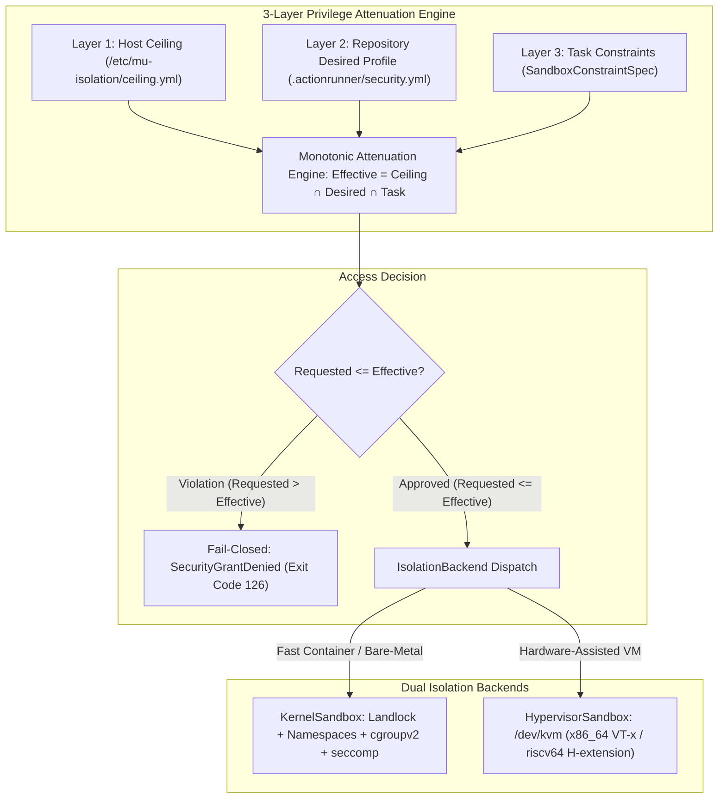

# MuIsolation Dual-Backend Sandbox Model & Privilege Attenuation

This document specifies the architecture, security invariants, and runtime execution models provided by **MuIsolation** (`LGPL-3.0-only WITH LGPL-3.0-linking-exception`), the sandboxing engine powering the ActionRunner CI and distributed workload execution fabric.

______________________________________________________________________

## 1. Architectural Mission

Workloads running on compute clusters range from trusted build scripts to arbitrary pull-request code and untrusted third-party binaries. To guarantee host safety, resource containment, and prevent lateral cluster movement, MuIsolation provides:

1. **3-Layer Monotonic Privilege Attenuation**: Declarative policy cascades where permissions can only shrink, never expand.
1. **Dual-Backend Isolation (`IsolationBackend` trait)**:
   - **`KernelSandbox`**: Fast, lightweight Linux kernel-level containment using Landlock LSM, namespaces, cgroupv2, `seccomp-bpf`, bounded `RLIMIT_MEMLOCK`, and conditional `/proc/set_ai_thread` registration for specialized RISC-V compute clusters.
   - **`HypervisorSandbox`**: Hardware-assisted microVM isolation backed by `/dev/kvm` across `x86_64` (Intel VT-x) and `riscv64` (RISC-V Hypervisor `H` extension).



______________________________________________________________________

## 2. 3-Layer Monotonic Privilege Attenuation

Privilege configuration flows through three strictly ordered evaluation layers:

- **Layer 1 — Operator Host Ceiling (`/etc/mu-isolation/ceiling.yml`)**:
  Owned and signed exclusively by cluster administrators. Configured locally on physical worker nodes (`0700 root:root`). Sets the absolute maximum resource, filesystem, and network grants that any process on this host may ever obtain.
- **Layer 2 — Repository Desired Profile (`.actionrunner/security.yml`)**:
  Committed within each project's repository. Maintainers declare named security profiles (e.g. `strict`, `standard`, `hardware-vector`) detailing expected capabilities for compilation, testing, and benchmarking.
- **Layer 3 — Per-Task Runtime Constraints (`SandboxConstraintSpec`)**:
  Specified in `.actionrunner/ActionRunner.yml` for individual tasks, optionally narrowing CPU quotas, memory ceilings, or network access for a single command.

### Monotonic Intersection Invariant

The effective execution grant $\\text{Effective}$ is computed via the strict mathematical intersection:

$$\\text{Effective} = \\text{Ceiling} \\cap \\text{Desired} \\cap \\text{Task}$$

No downstream layer can expand, override, or circumvent a constraint set by an upstream layer:

- If the host ceiling disallows network access, no repository profile or task can re-enable networking.
- If the repository profile specifies a 4 GiB memory limit, a task cannot declare an 8 GiB limit.

### Fail-Closed Rejection (`SecurityGrantDenied`)

If any field in `Desired` or `Task` attempts to exceed the boundary defined by `Ceiling` (e.g., requesting forbidden filesystem paths, elevated capabilities, unconfined networking, or excessive memory):

1. The validation engine fails immediately.
1. A structured error `SecurityGrantDenied` is returned to the runner.
1. The job aborts **prior to spawning any subprocess or allocating microVM memory**.

______________________________________________________________________

## 3. Dual Isolation Backends (`IsolationBackend` Trait)

All sandboxes implement the common Rust trait `IsolationBackend`:

```rust
pub trait IsolationBackend: Send + Sync {
    fn configure(&mut self, spec: &EffectiveSecurityGrant) -> Result<(), MuIsolationError>;
    fn spawn(&self, command: &CommandSpec) -> Result<Box<dyn ChildProcess>, MuIsolationError>;
    fn terminate(&self) -> Result<(), MuIsolationError>;
}
```

### Backend A: `KernelSandbox`

The `KernelSandbox` is designed for near-zero startup overhead (less than 2 ms) while running directly on bare-metal Linux. It combines multiple kernel subsystems:

#### 1. Landlock LSM (Filesystem Sandboxing)

- **Path Rules**: Compiles an unprivileged Landlock ruleset restricting access to explicitly granted paths.
- **Access Masks**:
  - `Read`: Read files, inspect directory contents, traverse paths (`LANDLOCK_ACCESS_FS_READ_FILE`, `LANDLOCK_ACCESS_FS_READ_DIR`).
  - `Write`: Write files, truncate, append (`LANDLOCK_ACCESS_FS_WRITE_FILE`).
  - `Exec`: Execute binaries (`LANDLOCK_ACCESS_FS_EXECUTE`).
- All undeclared paths (e.g., `/etc/shadow`, `/root`, other user homes) are denied by the kernel Landlock LSM.

#### 2. Linux Namespaces & Process Isolation

- **Mount Namespace (`CLONE_NEWNS`)**: Isolated private mount table with read-only root (`/`) and temporary private `/tmp` (tmpfs).
- **Network Namespace (`CLONE_NEWNET`)**: Default configuration detaches network access entirely, exposing only an unrouted `lo` loopback device.
- **PID Namespace (`CLONE_NEWPID`)**: Hides host processes; the sandboxed task becomes PID 1 inside its namespace.
- **User Namespace (`CLONE_NEWUSER`)**: Unprivileged root mapping, preventing real host UID 0 execution.
- **Privilege Escalation Prevention (`PR_SET_NO_NEW_PRIVS`)**: Invoked before `execve` to disallow setuid/setgid privilege escalation.

#### 3. Resource Accounting via `cgroupv2`

- Tasks run inside isolated cgroups under `/sys/fs/cgroup/mu-isolation/`.
- Hard resource caps:
  - `cpu.max`: Quota and period bounding CPU core utilization.
  - `memory.max`: Hard memory limit triggering immediate OOM kills if breached.
  - `memory.swap.max`: Set to `0` to prevent swap thrashing and SSD degradation.

#### 4. Syscall Filtering via `seccomp-bpf`

- A strict system call filter permits standard computation and I/O while blocking dangerous syscalls: `ptrace`, `chroot`, `mount`, `reboot`, `syslog`, `kexec_load`, `bpf`.

#### 5. Bounded Locked Memory Ceiling (`RLIMIT_MEMLOCK`)

On high-density compute nodes (such as 32 GB RISC-V nodes), processes using locked memory (e.g. inference cache arenas or DMA buffers) must **never** be granted `unlimited` `RLIMIT_MEMLOCK`. Unbounded limits risk hard system lockups by starving kernel slab allocators, page tables, and SSH services.

- MuIsolation enforces a strict, bounded ceiling:
  ```
  RLIMIT_MEMLOCK = 29360128 KB (28 GiB on 32 GB nodes)
  ```
  This preserves ~3.3 GiB exclusively for the headless Linux kernel, scheduler, and SSH services.

#### 6. Conditional `/proc/set_ai_thread` Registration (SpacemiT-Patched Kernel)

On heterogeneous SpacemiT Key Stone K3 hardware featuring Cluster 0 (`X100`, general-purpose cores 0–7) and Cluster 1 (`A100`, AI/Matrix cores 8–15):

- The SpacemiT vendor kernel (`spacemit-hmp`) requires worker threads pinned to A100 matrix cores to register their kernel thread ID via `/proc/set_ai_thread` before calling `sched_setaffinity`.
- **Conditional Handling**: MuIsolation verifies whether `/proc/set_ai_thread` is present. If present, it executes `SYS_gettid` and writes the thread ID to procfs; if absent (e.g., standard upstream Linux kernels), it cleanly skips the write without failure.

______________________________________________________________________

### Backend B: `HypervisorSandbox`

For workloads requiring complete kernel isolation (untrusted foreign code, untrusted network services, or experimental kernel drivers), MuIsolation provides `HypervisorSandbox` using `/dev/kvm`.

- **Hardware Virtualization Support**:
  - `x86_64`: Intel VT-x hardware virtualization.
  - `riscv64`: RISC-V Hypervisor (`H`) extension available on Cluster 0 (`X100`, cores 0–7, mask `0x00FF`, `VLEN = 256`).
- **Air-Gapped Guest Boundaries**:
  - Spawns a minimal microVM running a hardened, stripped Linux micro-kernel.
  - Root filesystem mounted via zero-copy read-only `virtio-fs`.
  - Virtual CPU (`vCPU`) quotas and memory sizes statically allocated at VM boot.
  - Any kernel panic or escape exploit is contained strictly within the ephemeral microVM.

______________________________________________________________________

## 4. Configuration Examples

### Host Ceiling: `/etc/mu-isolation/ceiling.yml`

```yaml
version: "1"
host:
  node_name: "worker-riscv64-01"
  max_memory_mb: 28672 # 28 GiB ceiling on 32 GB node
  max_rlimit_memlock_kb: 29360128 # 28 GiB bounded limit
  max_threads: 8

network:
  allow_external_egress: false
  allowed_internal_subnets:
    - "192.0.2.0/24"

filesystem:
  read_only_paths:
    - "/usr"
    - "/lib"
    - "/bin"
    - "/opt/toolchains"
  writable_tmpfs_quota_mb: 4096
  blocked_paths:
    - "/etc/shadow"
    - "/etc/mu-isolation"
    - "/var/run/docker.sock"
    - "/root"
```

### Repository Desired Profile: `.actionrunner/security.yml`

```yaml
version: "1"
profiles:
  strict:
    isolation_backend: "kernel"
    network:
      mode: "none"
    filesystem:
      workspace_access: "read-write"
      allow_tmpfs: true
      read_paths:
        - "/opt/toolchains/rust"
    limits:
      memory_mb: 4096
      threads: 2

  hardware-vector:
    isolation_backend: "kernel"
    network:
      mode: "none"
    hardware:
      cluster: "a100"
      core_mask: "0xFF00"
      require_ai_thread_hook: true
    limits:
      memory_mb: 16384
      rlimit_memlock_kb: 16777216
      threads: 6

  untrusted-evaluation:
    isolation_backend: "hypervisor"
    hypervisor:
      vcpus: 2
      memory_mb: 2048
      kernel_image: "/opt/vm-images/vmlinux-minimal"
    network:
      mode: "none"
```
