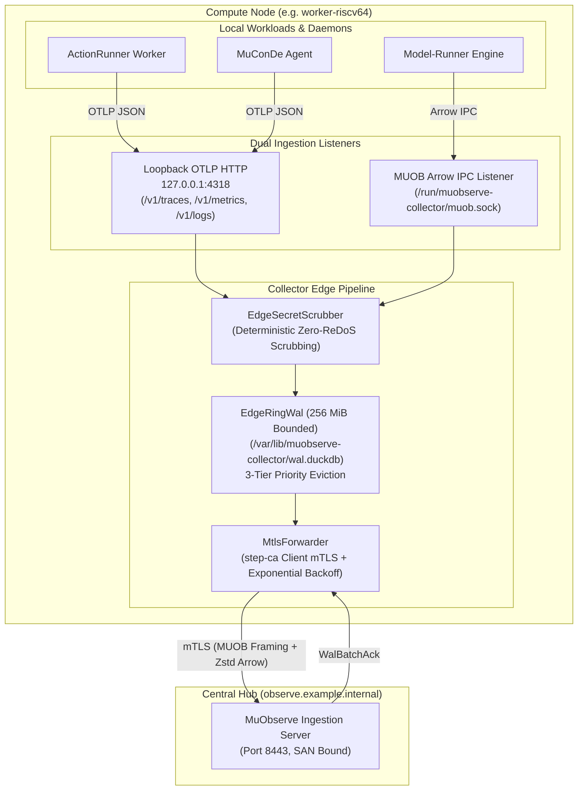

# `muobserve-collector` Architecture & Crate Reference

**Crate**: `muobserve-collector`\
**Version**: `0.1.0` (Edition 2021)\
**Role**: Sandboxed node-level edge telemetry collector daemon with OTLP/Arrow ingestion, streaming secret redaction, bounded DuckDB ring-buffer WAL, and step-ca mTLS upstream forwarding\
**Repository**: [`LMA1980/MuObserve-collector`](https://github.com/LMA1980/MuObserve-collector)\
**License**: `AGPL-3.0-only`

______________________________________________________________________

## 1. Purpose & System Context

`muobserve-collector` is the lightweight, node-level edge daemon deployed on every compute node across the distributed cluster fabric (such as bare-metal SpacemiT K3 boards and gateway hosts).

It addresses the fundamental challenges of edge observability:

1. **Low-Overhead Local Ingestion**: Accepts standard OpenTelemetry payloads over loopback HTTP and native `MUOB` zero-copy Arrow IPC streams from colocated workloads (`ActionRunner`, `MuConDe`, `model-runner`).
1. **Deterministic Credential Scrubbing**: Intercepts and scrubs tokens, secrets, and private keys inline prior to any disk storage.
1. **Bounded Ring-Buffer WAL**: Enforces a strict `256 MiB` disk ceiling (`wal.duckdb`) with 3-tier priority backpressure eviction to prevent disk exhaustion during upstream network outages.
1. **Resilient mTLS Forwarding**: Buffers batches locally, transmitting them upstream to centralized `MuObserve` over mutual TLS authenticated by internal `step-ca` certificates.
1. **Least-Privilege Kernel Confinement**: Confines daemon execution at startup using `MuIsolation` `KernelSandbox` (Linux Landlock LSM, namespaces, cgroupv2, and bounded `RLIMIT_MEMLOCK`).



______________________________________________________________________

## 2. Dual Local Ingestion Engine (`src/ingest.rs`)

`muobserve-collector` exposes two high-performance ingestion interfaces bound strictly to local loopback or local Unix Domain Sockets:

### 2.1 Loopback OTLP HTTP Ingestion (`127.0.0.1:4318`)

Implements standard OpenTelemetry Protocol (OTLP/HTTP) endpoints via Axum:

- **`POST /v1/traces`**: Ingests JSON/Protobuf OpenTelemetry trace payloads. Parses span hierarchies, timestamps, status codes, and attributes into columnar `OtelSpanEntry` Arrow batches.
- **`POST /v1/metrics`**: Ingests gauge, sum, and histogram metrics. Extracts metric names, units, values, and hardware attributes (such as `cpu_cluster`, `vlen_bits`, and `memlock_used_bytes`) into `OtelMetricEntry` batches.
- **`POST /v1/logs`**: Ingests structured log records, correlating them with W3C `trace_id` and `span_id` into `OtelLogEntry` batches.
- **`GET /healthz`**: Liveness probe returning HTTP 200 OK and collector status JSON.

### 2.2 Native `MUOB` Arrow IPC Listener

For internal Rust daemons (`ActionRunner-rs`, `model-runner`), the collector provides a zero-copy Unix Domain Socket listener (`/run/muobserve-collector/muob.sock`) and loopback TCP listener:

- Accepts 24-byte `IpcHeader` frames with magic `*b"MUOB"`.
- Demultiplexes typed message payloads:
  - `MSG_TYPE_ARROW_OTEL_LOGS` (`0x0010`)
  - `MSG_TYPE_ARROW_OTEL_SPANS` (`0x0011`)
  - `MSG_TYPE_ARROW_OTEL_METRICS` (`0x0012`)
  - `MSG_TYPE_ARROW_TEST_RUNS` (`0x0013`)
  - `MSG_TYPE_ARROW_BENCH_RUNS` (`0x0014`)
- Streams batches directly through memory buffers into the scrubber and WAL without intermediate JSON deserialization.

______________________________________________________________________

## 3. Streaming `EdgeSecretScrubber` (`src/scrubber.rs`)

Edge nodes frequently handle sensitive operational parameters: build environment variables, deploy keys, API tokens, and webhook secrets.

To prevent credentials from ever being written to disk or transmitted across network links, `EdgeSecretScrubber` executes synchronous, deterministic in-memory scrubbing on every received batch:

```rust
pub struct EdgeSecretScrubber {
    redactor: Arc<dyn SecretRedactor>,
}
```

### 3.1 In-Memory Scrubbing Guarantees

1. **Zero Disk Exposure**: Telemetry strings (`body`, `attributes_json`, failure backtraces) pass through `redact_in_place()` before WAL disk writes.
1. **Zero-ReDoS Protection**: Pattern evaluation avoids catastrophic backtracking expressions, running linear-time scans over strings.
1. **High-Priority Classification**: Inspects log severity numbers (`is_high_priority_log`). Entries with `severity_number >= 13` (WARN, ERROR, FATAL) are tagged with `FLAG_HIGH_PRIORITY` (`0x0004`) to ensure they survive storage pressure.

______________________________________________________________________

## 4. Bounded `256 MiB` Edge Ring-Buffer WAL (`src/wal.rs`)

Edge compute nodes (particularly embedded 32 GB RISC-V nodes) operate with bounded local storage. If centralized telemetry servers are temporarily unreachable, an unconstrained WAL risks exhausting host disk space.

`EdgeRingWal` manages an embedded DuckDB write-ahead log under strict operational ceilings:

```rust
pub const DEFAULT_MAX_WAL_BYTES: usize = 256 * 1024 * 1024; // 256 MiB
pub const DEFAULT_MAX_AGE_SECS: u64 = 86_400;                // 24 hours
pub const DEFAULT_WAL_PATH: &str = "/var/lib/muobserve-collector/wal.duckdb";
```

### 4.1 3-Tier Priority Eviction Policy

When WAL utilization approaches `max_wal_bytes`, `EdgeRingWal` executes deterministic backpressure eviction governed by `WalSignalPriority`:

| Priority Tier        | `WalSignalPriority`    | Signal Types                                                                                                                                   | Eviction Order                                                                             |
| -------------------- | ---------------------- | ---------------------------------------------------------------------------------------------------------------------------------------------- | ------------------------------------------------------------------------------------------ |
| **Tier 0 (Lowest)**  | `LowDebugLog` (`0`)    | Debug, trace, and info logs (`severity_number < 13`).                                                                                          | **Evicted First**: Dropped immediately upon memory/disk pressure.                          |
| **Tier 1 (Medium)**  | `StandardSignal` (`1`) | Standard traces, healthy spans, and routine system metrics.                                                                                    | **Evicted Second**: Preserved until Tier 0 is fully purged.                                |
| **Tier 2 (Highest)** | `HighCritical` (`2`)   | Error/fatal logs (`severity_number >= 13`), test runs (`TestCaseRunEntry`), benchmarks (`BenchmarkRunEntry`), and `FLAG_HIGH_PRIORITY` frames. | **Strictly Preserved**: Never dropped while lower tiers exist; held for upstream delivery. |

### 4.2 WAL Lifecycle & Truncation

1. **Append**: Ingested and scrubbed Arrow batches are appended to `/var/lib/muobserve-collector/wal.duckdb` with a monotonically increasing `sequence` number.
1. **Replication**: `MtlsForwarder` reads unacknowledged batches in sequence order and streams them to the centralized hub.
1. **Acknowledgment & Truncation**: Upon receipt of a valid `WalBatchAck` frame matching the flushed sequence range, `EdgeRingWal` atomically truncates acknowledged records.
1. **Aging**: Background GC purges batches exceeding `max_age_secs` (`86,400s` / 24h).

______________________________________________________________________

## 5. `step-ca` mTLS Forwarder (`src/forwarder.rs`)

`MtlsForwarder` delivers buffered WAL batches over a resilient TLS connection authenticated by mutual certificates:

- **PKI Infrastructure**: Backed by internal `step-ca` mutual TLS.
- **Client Identity**: The collector presents a client certificate containing its canonical node identifier as a Subject Alternative Name (SAN) (e.g. `DNS:worker-riscv64.observe.example.internal`).
- **Server Verification**: Validates the upstream server's certificate against the trusted `step-ca` root certificate bundle.
- **Exponential Backoff**: If upstream is unreachable, the forwarder retries with jittered exponential backoff (100ms up to 30s) while the local WAL buffers telemetry.
- **Frame Pipeline**: Transmits 24-byte `IpcHeader` frames with `MSG_TYPE_ARROW_*` constants, supporting on-the-fly Zstd batch compression (`FLAG_COMPRESSED`).

______________________________________________________________________

## 6. `MuIsolation` `KernelSandbox` Confinement

In accordance with platform security invariants, `muobserve-collector` isolates its own execution at startup using `MuIsolation` `KernelSandbox`:

```rust
pub struct CollectorSandboxConfig {
    pub node_id: String,
    pub arch: String,
    pub state_dir: PathBuf,           // /var/lib/muobserve-collector
    pub config_dir: PathBuf,          // /etc/muobserve-collector
    pub memlock_limit_kb: u64,        // Bounded memlock limit
    pub max_pids: u32,                // Process budget
    pub max_memory_mb: u64,           // cgroupv2 memory bound
    pub max_cpu_cores: u32,           // Allowed CPU core count
    pub enforce_landlock_on_linux: bool,
}
```

### 6.1 Landlock Filesystem Attenuation

- **Read-Write Access**: Strictly restricted to `/var/lib/muobserve-collector` (state directory & WAL) and `/run/muobserve-collector` (Unix domain socket).
- **Read-Only Access**: Strictly restricted to `/etc/muobserve-collector` (TLS credentials and configuration) and `/etc/ssl/certs` (system CA bundle).
- **Default Deny**: All other host directories (including `/home`, `/root`, `/bin`, and user repositories) are completely blocked from read and write access.

### 6.2 Host Resource Bounds

- **Namespaces**: Launches within private Linux namespaces (`CLONE_NEWNS`, `CLONE_NEWPID`).
- **Memory Ceiling**: Governed by cgroupv2 `memory.max` and a conservative `RLIMIT_MEMLOCK` ceiling.
- **Thread Model**: Pinned to reserved host control threads, never competing with cycle-exclusive compute workers or CI stage runners.

______________________________________________________________________

## 7. Licensing & Governance

- **License**: `AGPL-3.0-only`\
  In line with the workspace two-tier licensing policy for standalone services, daemons, and controllers.
- **Privacy Boundary (`AGENTS.md §2`)**: Public documentation, telemetry schemas, and default configurations strictly use generic host placeholders (`worker-riscv64`, `node-a`, `observe.example.internal`, `192.0.2.x`).
