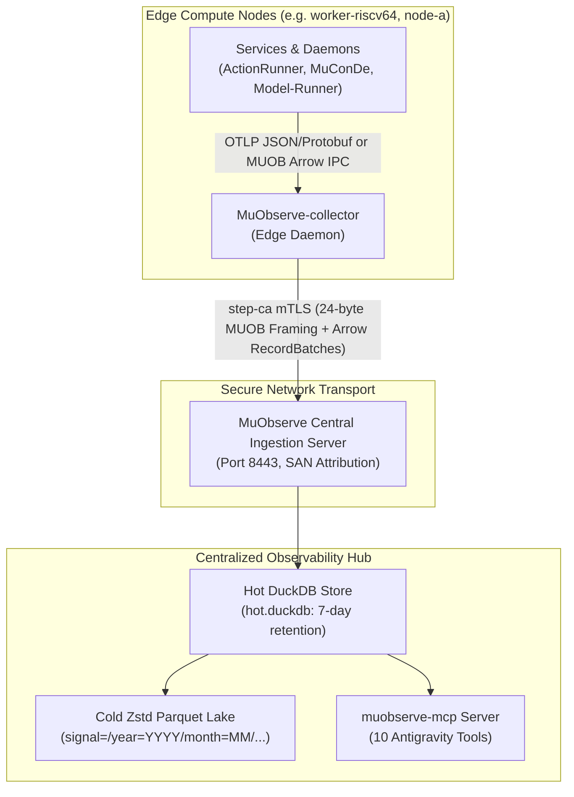

# `muobserve-ipc` Architecture & Crate Reference

**Crate**: `muobserve-ipc`\
**Version**: `0.1.0` (Edition 2021)\
**Role**: Shared zero-copy wire framing, Apache Arrow telemetry batch schemas, W3C trace context propagation, streaming secret redactor contracts, and Apache Fory RPC envelopes\
**Repository**: [`LMA1980/MuObserve-ipc`](https://github.com/LMA1980/MuObserve-ipc)\
**License**: `LGPL-3.0-only WITH LGPL-3.0-linking-exception`

______________________________________________________________________

## 1. Purpose & System Context

`muobserve-ipc` serves as the foundational, zero-copy transport and serialization library for the **MuObserve** distributed observability and regression analytics platform across the heterogeneous K3 compute fabric.

It provides shared type contracts and binary serialization for:

1. **Zero-Copy Memory-Aligned Framing**: A 24-byte 8-byte-aligned header (`IpcHeader`) with magic bytes `*b"MUOB"` for direct pointer casting via `zerocopy`.
1. **Columnar Apache Arrow Telemetry Schemas**: High-throughput vectorized batches for OpenTelemetry logs, distributed spans, hardware metrics, test runs, and micro-benchmark statistics.
1. **W3C Distributed Trace Context**: Standard `traceparent` (`00-<trace_id>-<span_id>-<flags>`) parsing and serialization conforming strictly to W3C Trace Context specifications.
1. **Deterministic Secret Scrubbing**: Compile-time `SecretRedactor` trait and zero-ReDoS `RegexSecretRedactor` (`DeterministicSecretRedactor`) preventing credential leakage before WAL persistence.
1. **Apache Fory RPC Envelopes**: High-speed, schema-checked RPC messages coordinating centralized CI job histories, branch snapshots, hardware-stratified regression gates, and canary SLO evaluations.



______________________________________________________________________

## 2. 24-Byte Zero-Copy Binary Framing (`src/framing.rs`)

To achieve maximum throughput on heterogeneous RISC-V and x86_64 nodes with minimal serialization CPU overhead, all IPC communication begins with a fixed-size, 8-byte-aligned 24-byte header:

```rust
#[derive(IntoBytes, FromBytes, KnownLayout, Immutable, Debug, PartialEq, Eq, Clone, Copy)]
#[repr(C, align(8))]
pub struct IpcHeader {
    pub magic: [u8; 4],      // *b"MUOB" (0x4D, 0x55, 0x4F, 0x42)
    pub version: u16,        // CURRENT_VERSION = 1
    pub msg_type: u16,       // Wire message identifier
    pub payload_len: u32,    // Up to 16 MiB (MAX_FRAME_SIZE = 16 * 1024 * 1024)
    pub flags: u32,          // Frame flags (FLAG_COMPRESSED, FLAG_HIGH_PRIORITY, etc.)
    pub sequence: u64,       // Monotonic sequence counter for WAL ordering
}
```

### 2.1 Binary Layout Diagram

```
 0                   1                   2                   3
 0 1 2 3 4 5 6 7 8 9 0 1 2 3 4 5 6 7 8 9 0 1 2 3 4 5 6 7 8 9 0 1
+-+-+-+-+-+-+-+-+-+-+-+-+-+-+-+-+-+-+-+-+-+-+-+-+-+-+-+-+-+-+-+-+
|                 Magic Bytes: "MUOB" (0x4D554F42)              |
+-+-+-+-+-+-+-+-+-+-+-+-+-+-+-+-+-+-+-+-+-+-+-+-+-+-+-+-+-+-+-+-+
|         Version (u16)         |       Message Type (u16)      |
+-+-+-+-+-+-+-+-+-+-+-+-+-+-+-+-+-+-+-+-+-+-+-+-+-+-+-+-+-+-+-+-+
|                      Payload Length (u32)                     |
+-+-+-+-+-+-+-+-+-+-+-+-+-+-+-+-+-+-+-+-+-+-+-+-+-+-+-+-+-+-+-+-+
|                          Flags (u32)                          |
+-+-+-+-+-+-+-+-+-+-+-+-+-+-+-+-+-+-+-+-+-+-+-+-+-+-+-+-+-+-+-+-+
|                                                               |
+                    Monotonic Sequence (u64)                   +
|                                                               |
+-+-+-+-+-+-+-+-+-+-+-+-+-+-+-+-+-+-+-+-+-+-+-+-+-+-+-+-+-+-+-+-+
```

### 2.2 Wire Constants & Frame Flags

| Constant                      | Value      | Description                                                                    |
| ----------------------------- | ---------- | ------------------------------------------------------------------------------ |
| `MAGIC`                       | `*b"MUOB"` | Canonical 4-byte stream identifier (`0x4D554F42`).                             |
| `CURRENT_VERSION`             | `1`        | Wire protocol version. Frames with mismatched versions fail closed.            |
| `HEADER_SIZE`                 | `24` bytes | Fixed byte width of `IpcHeader`.                                               |
| `MAX_FRAME_SIZE`              | `16 MiB`   | Maximum allowable frame payload to prevent memory denial-of-service.           |
| `MSG_TYPE_FORY_CONTROL`       | `0x0001`   | Apache Fory RPC request/response frame.                                        |
| `MSG_TYPE_WAL_ACK`            | `0x0002`   | Edge collector WAL batch acknowledgment frame (`WalBatchAck`).                 |
| `MSG_TYPE_ARROW_OTEL_LOGS`    | `0x0010`   | Apache Arrow IPC stream containing `OtelLogEntry` records.                     |
| `MSG_TYPE_ARROW_OTEL_SPANS`   | `0x0011`   | Apache Arrow IPC stream containing `OtelSpanEntry` records.                    |
| `MSG_TYPE_ARROW_OTEL_METRICS` | `0x0012`   | Apache Arrow IPC stream containing `OtelMetricEntry` records.                  |
| `MSG_TYPE_ARROW_TEST_RUNS`    | `0x0013`   | Apache Arrow IPC stream containing `TestCaseRunEntry` records.                 |
| `MSG_TYPE_ARROW_BENCH_RUNS`   | `0x0014`   | Apache Arrow IPC stream containing `BenchmarkRunEntry` records.                |
| `FLAG_COMPRESSED`             | `0x0001`   | Indicates payload is compressed with Zstandard.                                |
| `FLAG_END_OF_STREAM`          | `0x0002`   | Marks the terminal frame in a logical stream.                                  |
| `FLAG_HIGH_PRIORITY`          | `0x0004`   | High-priority signal (errors, tests, benchmarks) preserved under backpressure. |

______________________________________________________________________

## 3. Apache Arrow Columnar Batch Schemas

Telemetry payloads are serialized as standard Apache Arrow IPC `RecordBatch` streams, enabling zero-copy ingest directly into DuckDB and cold Zstd Parquet files without per-row object deserialization.

### 3.1 `OtelLogEntry` (Logs Schema)

Correlates structured OpenTelemetry log records with W3C `trace_id` and `span_id`:

```rust
pub struct OtelLogEntry {
    pub timestamp_unix_nano: i64,   // Timestamp(Nanosecond)
    pub trace_id: String,           // 32-char hex string
    pub span_id: String,            // 16-char hex string
    pub severity_number: i32,       // OTEL severity (e.g. 9=INFO, 13=WARN, 17=ERROR)
    pub severity_text: String,       // "INFO", "WARN", "ERROR", "FATAL"
    pub service_name: String,        // Source service (e.g. "action-runner")
    pub node_id: String,             // Node identity (e.g. "worker-riscv64")
    pub body: String,                // Log message payload (scrubbed)
    pub attributes_json: String,     // JSON dictionary of attributes (scrubbed)
    pub job_id: Option<String>,      // Optional ActionRunner job attribution
    pub stage_id: Option<String>,    // Optional ActionRunner stage attribution
}
```

### 3.2 `OtelSpanEntry` (Traces Schema)

Represents distributed execution spans with hierarchical parent-child linking:

```rust
pub struct OtelSpanEntry {
    pub trace_id: String,           // 32-char hex string
    pub span_id: String,            // 16-char hex string
    pub parent_span_id: Option<String>, // Parent span if nested
    pub service_name: String,        // Source service identifier
    pub node_id: String,             // Execution node identifier
    pub span_name: String,           // Logical operation (e.g. "stage:cargo-test")
    pub span_kind: String,           // "INTERNAL", "SERVER", "CLIENT", "PRODUCER"
    pub start_time_unix_nano: i64,  // Timestamp(Nanosecond)
    pub end_time_unix_nano: i64,    // Timestamp(Nanosecond)
    pub duration_ns: u64,           // Nanosecond execution duration
    pub status_code: String,         // "UNSET", "OK", "ERROR"
    pub status_message: Option<String>, // Error description if status_code == "ERROR"
    pub attributes_json: String,     // JSON dictionary of span attributes
}
```

### 3.3 `OtelMetricEntry` (Metrics Schema)

Stores granular node-level metrics, hardware utilization, and SpacemiT K3 cluster affinity tags:

```rust
pub struct OtelMetricEntry {
    pub timestamp_unix_nano: i64,       // Timestamp(Nanosecond)
    pub service_name: String,            // Emitting service name
    pub node_id: String,                 // Host node identifier
    pub metric_name: String,             // e.g. "cpu_cycles", "instructions", "memlock_used"
    pub metric_unit: String,             // "bytes", "ns", "count", "percent"
    pub value_f64: f64,                  // Metric measurement value
    pub arch: String,                    // "riscv64gc", "x86_64", etc.
    pub cpu_cluster: Option<String>,     // "X100", "A100", or generic cluster tag
    pub vlen_bits: Option<u32>,          // 256 (X100) or 1024 (A100)
    pub memlock_used_bytes: Option<u64>, // Current locked memory usage
    pub memlock_limit_bytes: Option<u64>,// Configured RLIMIT_MEMLOCK bound
    pub trace_id: Option<String>,        // Correlated trace if metric sampled in span
    pub span_id: Option<String>,         // Correlated span if applicable
    pub attributes_json: String,         // Additional tags as JSON
}
```

### 3.4 `TestCaseRunEntry` (Regression Test Schema)

Tracks individual unit, integration, and doc test executions for historical flakiness scoring:

```rust
pub struct TestCaseRunEntry {
    pub job_id: String,                  // Pipeline job identifier
    pub repo_key: String,                // Repository key (e.g. "LMA1980/k3-core")
    pub branch_key: String,              // Git branch or PR ref
    pub commit_sha: String,              // 40-char commit SHA
    pub crate_name: String,              // Cargo crate name
    pub test_binary: String,             // Executable test target
    pub test_name: String,               // Canonical test path (e.g. "tests::it_works")
    pub status: String,                  // "PASSED", "FAILED", "IGNORED"
    pub duration_ms: f64,                // Test duration in milliseconds
    pub failure_summary: Option<String>, // Panic message or failure backtrace
    pub timestamp_unix_nano: i64,       // Execution timestamp
    pub node_id: String,                 // Execution worker node
    pub arch: String,                    // Target architecture
}
```

### 3.5 `BenchmarkRunEntry` (Hardware-Stratified Micro-Benchmarks)

Records statistical benchmark samples strictly stratified by CPU cluster and vector length:

```rust
pub struct BenchmarkRunEntry {
    pub job_id: String,                  // Pipeline job identifier
    pub repo_key: String,                // Repository key
    pub branch_key: String,              // Branch key
    pub commit_sha: String,              // Git commit SHA
    pub crate_name: String,              // Benchmarked crate
    pub bench_name: String,              // Benchmark function name
    pub ns_per_iter: f64,                // Mean nanoseconds per iteration
    pub std_dev_ns: f64,                 // Standard deviation
    pub mad_ns: f64,                     // Median Absolute Deviation
    pub p50_ns: f64,                     // 50th percentile latency
    pub p95_ns: f64,                     // 95th percentile latency
    pub p99_ns: f64,                     // 99th percentile latency
    pub throughput_value: Option<f64>,   // Calculated throughput
    pub throughput_unit: Option<String>, // e.g. "bytes/sec", "elements/sec"
    pub arch: String,                    // Target architecture ("riscv64gc")
    pub cpu_cluster: String,             // "X100" or "A100"
    pub vlen_bits: u32,                  // 256 or 1024
    pub timestamp_unix_nano: i64,       // Run timestamp
    pub node_id: String,                 // Benchmark host node
}
```

______________________________________________________________________

## 4. W3C Trace Context & Secret Scrubbing

### 4.1 `W3cTraceContext` (`TraceContext`)

Conforms to W3C Trace Context Level 1 specifications:

- **Format**: `00-<32-hex-trace-id>-<16-hex-span-id>-<2-hex-flags>`
- **Validation**: All-zero `trace_id` (`[0u8; 16]`) and all-zero `span_id` (`[0u8; 8]`) are strictly rejected with `IpcError::InvalidTraceContext`.
- **Sampling Flag**: `TRACE_FLAG_SAMPLED = 0x01`.
- **Interoperability**: Provides `from_traceparent_header(&str)` and `to_traceparent_header() -> String`.

### 4.2 `SecretRedactor` Trait & `RegexSecretRedactor`

Edge collectors scrub raw telemetry before it is written to the local WAL or streamed across the network:

```rust
pub trait SecretRedactor: Send + Sync {
    fn redact(&self, input: &str) -> String;
}
```

`RegexSecretRedactor` (aliased to `DeterministicSecretRedactor`) implements a deterministic, zero-ReDoS multi-pass replacement:

- **PEM Blocks**: `-----BEGIN [A-Z ]*PRIVATE KEY----- ... -----END [A-Z ]*PRIVATE KEY-----` $\\to$ `[REDACTED:MUOBSERVE]`
- **Bearer Tokens**: `Bearer [A-Za-z0-9\-_=.]+` $\\to$ `Bearer [REDACTED:MUOBSERVE]`
- **Known Token Prefixes**: `ghp_`, `gho_`, `ghs_`, `ghu_`, `ghr_`, `github_pat_` $\\to$ `[REDACTED:MUOBSERVE]`
- **Cloud Credentials**: AWS access key IDs (`AKIA[0-9A-Z]{16}`, `ASIA[0-9A-Z]{16}`) $\\to$ `[REDACTED:MUOBSERVE]`
- **Key-Value Secrets**: Case-insensitive matches for `password`, `secret`, `token`, `api_key`, `apikey`, `client_secret`, `webhook_secret` followed by `=`, `:`, or `": "` $\\to$ `[REDACTED:MUOBSERVE]`

______________________________________________________________________

## 5. Apache Fory RPC Envelopes (`src/control.rs`)

`muobserve-ipc` defines high-speed, schema-checked RPC envelopes using Apache Fory (`fory`) for cross-service control messages:

```
┌────────────────────────────────────────────────────────────────────────┐
│                        ControlRpcEnvelope (Fory)                       │
├────────────────────────────────┬───────────────────────────────────────┤
│ Centralized Job Records        │ • UpsertJobRecordRequest / Response   │
│                                │ • UpsertJobBatchRequest               │
│                                │ • QueryJobsHistoryRequest / Response  │
├────────────────────────────────┼───────────────────────────────────────┤
│ Centralized Snapshot State     │ • QueryBranchSnapshotsRequest / Resp  │
│                                │ • QuerySubmoduleSnapshotsRequest / Resp│
├────────────────────────────────┼───────────────────────────────────────┤
│ Regression Gate Decisions      │ • RegressionGateRequest               │
│                                │ • RegressionGateReport (Verdict)      │
├────────────────────────────────┼───────────────────────────────────────┤
│ Canary SLO Assertions          │ • CanarySloAssertionRequest           │
│                                │ • CanarySloAssertionResponse          │
├────────────────────────────────┼───────────────────────────────────────┤
│ WAL Synchronization            │ • WalBatchAck (Sequence Truncation)   │
└────────────────────────────────┴───────────────────────────────────────┘
```

### 5.1 Key Public RPC Structs

- **`CentralJobRecord`**: Centralized historical record capturing job UUID, event type, repository key, commit SHA, branch ref, duration, exit code, quality score, letter grade, test counts, coverage %, and clippy warning counts.
- **`CentralBranchSnapshot`**: High-water mark snapshot of the latest active and latest completed jobs for a given `(repo_key, branch_key)`.
- **`CentralSubmoduleSnapshot`**: Submodule synchronization tracking latest active and completed jobs across child modules.
- **`RegressionGateRequest` & `RegressionGateReport`**:
  - Request parameters: `repo_key`, `candidate_commit`, `baseline_branch`, `max_slowdown_pct` (default `5.0%`), and `max_flakiness_pct` (default `2.0%`).
  - Report output: `RegressionVerdict` (`Pass`, `Warn`, `Fail`), list of `BenchmarkRegressionItem` detections (with `delta_pct` and `mad_z_score`), list of `TestRegressionItem` detections, and human-readable summary.
- **`CanarySloAssertionRequest` & `CanarySloAssertionResponse`**:
  - Request parameters: `service_name`, `candidate_digest`, `node_id`, `bake_window_secs`, `max_error_logs`, and `max_p99_latency_ms`.
  - Response output: `healthy: bool`, `error_log_count: u32`, `p99_latency_ms: f64`, `taint_recommended: bool`, and diagnostic reason string.
- **`WalBatchAck`**: Confirms durable persistence of sequence batches in centralized DuckDB, instructing `MuObserve-collector` to safely truncate its local ring-buffer WAL.

______________________________________________________________________

## 6. Licensing & Downstream Dependencies

- **License**: `LGPL-3.0-only WITH LGPL-3.0-linking-exception`\
  Permits proprietary and open-source applications (such as CI controllers, monitoring frontends, and inference engines) to link dynamically or statically against `muobserve-ipc` without infectious copyleft restrictions on the calling application itself.
- **Dependencies**: `zerocopy`, `fory`, `arrow`, `tokio`, `bytes`, `serde`, `serde_json`, `thiserror`.
- **Consumers**:
  - `MuObserve-collector`: Ingests and batches local telemetry into Arrow IPC streams.
  - `MuObserve`: Centralized server decoding Arrow batches and answering Fory RPC requests.
  - `ActionRunner-controller`: Queries centralized history and invokes regression gates.
  - `MuConDe-controller`: Evaluates canary bake SLOs during zero-downtime rollouts.
