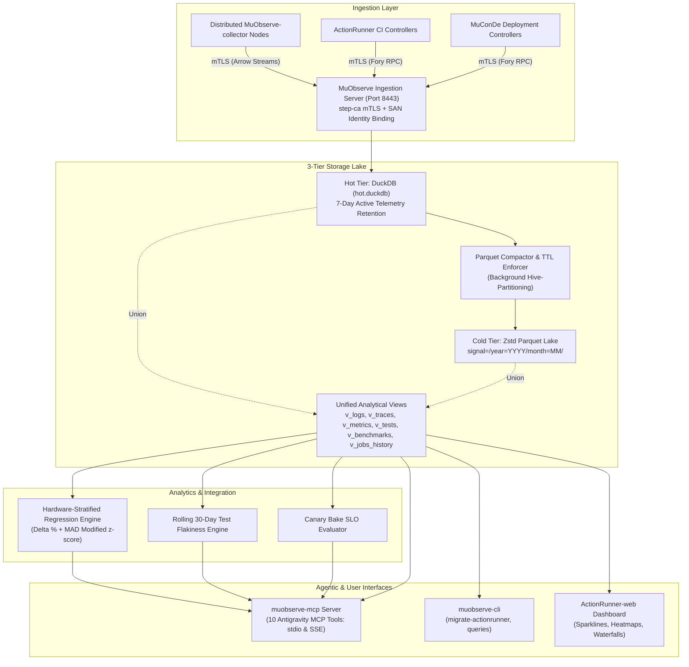

# `muobserve` Architecture & Crate Reference

**Crate**: `muobserve`\
**Version**: `0.1.0` (Edition 2021)\
**Role**: Distributed OTEL + DuckDB/Parquet observability backend, centralized CI state store, hardware-aware benchmark and test regression analytics engine, and Antigravity Model Context Protocol (MCP) server\
**Repository**: [`LMA1980/MuObserve`](https://github.com/LMA1980/MuObserve)\
**Binaries**: `muobserve`, `muobserve-mcp`, `muobserve-cli`\
**License**: `AGPL-3.0-only`

______________________________________________________________________

## 1. Purpose & System Context

`muobserve` is the centralized observability hub, state catalog, and analytics intelligence engine for the distributed K3 heterogeneous compute ecosystem.

It replaces scattered ad-hoc logs and standalone SQLite/DuckDB databases with a unified, high-performance telemetry platform that provides:

1. **Zero-Trust Ingestion**: Mutual TLS ingestion server bound to internal `step-ca` certificates with cryptographically enforced Subject Alternative Name (SAN) node identity attribution.
1. **3-Tier Storage Architecture**: High-speed hot DuckDB (`hot.duckdb`), background Hive-partitioned cold Zstd Parquet files (`signal=<type>/year=YYYY/month=MM/...`), and unified analytical views (`v_*`).
1. **Hardware-Stratified Regression Engine**: Statistical performance evaluation isolating heterogeneous CPU clusters (e.g. SpacemiT K3 Cluster 0 `X100` $VLEN=256$ vs Cluster 1 `A100` $VLEN=1024$), calculating percentage deltas and Median Absolute Deviation (MAD) modified $z$-scores.
1. **Rolling Test Flakiness & Canary Bake SLO Evaluators**: Rolling 30-day flip-flop flakiness scoring and automated canary bake SLO health assertion for `MuConDe` deployments.
1. **Native Antigravity MCP Server (`muobserve-mcp`)**: Model Context Protocol integration exposing 10 specialized observability tools over `stdio` and HTTP/SSE with guarded read-only SQL analytics.
1. **Centralized CI History & Migration CLI (`muobserve-cli`)**: Historical state migration tool (`migrate-actionrunner`) unifying past pipeline runs.



______________________________________________________________________

## 2. Zero-Trust `step-ca` mTLS SAN-Bound Ingestion (`src/server/mtls_ingest.rs`)

`MtlsIngestServer` terminates incoming client connections on TCP port `8443` using `tokio-rustls`.

### 2.1 Cryptographic Identity Attribution

To prevent rogue processes or compromised worker nodes from forging telemetry or attributing metrics to other nodes, the server extracts Subject Alternative Names (SANs) from client TLS certificates issued by `step-ca`:

- **Client SAN Format**: `DNS:worker-riscv64.observe.example.internal` or `URI:spiffe://example.internal/ns/ci/sa/worker-riscv64`
- **Identity Parsing**: Extracts `node_id` and optional `service_name` via `resolve_san_identity()`.

### 2.2 `SanEnforcementPolicy`

Configured via `IngestServerConfig`:

```rust
pub enum SanEnforcementPolicy {
    /// Rejects any batch whose node_id or service_name mismatches the cert SAN.
    RejectMismatch,
    /// Overrides incoming batch node_id and service_name with verified cert SAN.
    OverrideWithCertSan,
}
```

In production, `RejectMismatch` fails closed with `MuObserveError::SanViolation` if an edge collector attempts to report data under another node's identity.

______________________________________________________________________

## 3. 3-Tier Storage Architecture

`muobserve` balances high-speed streaming writes, sub-millisecond query latencies, and long-term cost efficiency through a 3-tier storage architecture:

### 3.1 Hot Tier: Embedded DuckDB (`hot.duckdb`)

- Located at `/var/lib/muobserve/hot.duckdb`.
- Retains active telemetry for 7 days (`DEFAULT_HOT_RETENTION_DAYS = 7`).
- Native columnar storage with vectorized execution.
- Relational tables:
  - `otel_logs`: Structured OpenTelemetry logs.
  - `otel_spans`: Distributed trace spans.
  - `otel_metrics`: System metrics and hardware performance counters.
  - `test_case_runs`: Per-test execution outcomes.
  - `benchmark_runs`: Per-benchmark iteration metrics.
  - `jobs_history`: Centralized ActionRunner CI job execution records.

### 3.2 Cold Tier: Hive-Partitioned Zstd Parquet Files

Managed by `ParquetCompactor` and `CompactorConfig`:

- **Hive Directory Layout**:
  ```
  parquet_root/
  ├── signal=logs/year=2026/month=11/part-1761998400000000000.parquet
  ├── signal=spans/year=2026/month=11/part-1761998400000000000.parquet
  ├── signal=metrics/year=2026/month=11/part-1761998400000000000.parquet
  ├── signal=tests/year=2026/month=11/part-1761998400000000000.parquet
  ├── signal=benchmarks/year=2026/month=11/part-1761998400000000000.parquet
  └── signal=jobs_history/year=2026/month=11/part-1761998400000000000.parquet
  ```
- **Compression**: Standard Zstandard compression achieving 80–90% storage reduction.
- **Compaction Cycle**: Background worker periodically exports rows older than 7 days into Parquet and deletes them from `hot.duckdb`.
- **TTL Enforcer**: Enforces configurable TTL (30–90 days) on raw debug logs while keeping test results and benchmark records permanently.

### 3.3 Unified Analytical Views (`src/storage/views.rs`)

DuckDB views automatically synthesize hot and cold data using `UNION ALL` and DuckDB's `read_parquet(..., hive_partitioning = true, union_by_name = true)`:

| View Name        | Hot Table Source | Cold Parquet Signal   | Key Columns                                                                                                                                                   |
| ---------------- | ---------------- | --------------------- | ------------------------------------------------------------------------------------------------------------------------------------------------------------- |
| `v_logs`         | `otel_logs`      | `signal=logs`         | `timestamp_unix_nano`, `trace_id`, `span_id`, `severity_number`, `severity_text`, `service_name`, `node_id`, `body`, `job_id`, `stage_id`                     |
| `v_traces`       | `otel_spans`     | `signal=spans`        | `trace_id`, `span_id`, `parent_span_id`, `service_name`, `node_id`, `span_name`, `start_time_unix_nano`, `duration_ns`, `status_code`                         |
| `v_metrics`      | `otel_metrics`   | `signal=metrics`      | `timestamp_unix_nano`, `service_name`, `node_id`, `metric_name`, `value_f64`, `arch`, `cpu_cluster`, `vlen_bits`, `memlock_used_bytes`                        |
| `v_tests`        | `test_case_runs` | `signal=tests`        | `job_id`, `repo_key`, `branch_key`, `commit_sha`, `crate_name`, `test_binary`, `test_name`, `status`, `duration_ms`, `node_id`                                |
| `v_benchmarks`   | `benchmark_runs` | `signal=benchmarks`   | `job_id`, `repo_key`, `branch_key`, `commit_sha`, `crate_name`, `bench_name`, `ns_per_iter`, `mad_ns`, `p50_ns`, `p99_ns`, `arch`, `cpu_cluster`, `vlen_bits` |
| `v_jobs_history` | `jobs_history`   | `signal=jobs_history` | `job_id`, `event_type`, `repo_key`, `commit_sha`, `ref_name`, `status_state`, `exit_code`, `duration_secs`, `quality_score`, `letter_grade`                   |

Analysts and agents query these views seamlessly without needing to know whether records reside in hot RAM/disk or cold Parquet.

______________________________________________________________________

## 4. Hardware-Stratified Regression Analytics Engine (`src/analytics/`)

### 4.1 Hardware-Stratified Benchmark Isolation

Comparing execution latencies across heterogeneous RISC-V cores and architectures produces invalid regression signals if CPU topology is ignored.

`evaluate_benchmark_regressions` strictly stratifies baselines by:
$$\\text{Stratification Key} = (\\text{repo_key}, \\text{crate_name}, \\text{bench_name}, \\text{arch}, \\text{cpu_cluster}, \\text{vlen_bits})$$

This guarantees that:

- Cluster 0 (`X100`, Out-of-Order 2.15 GHz, $VLEN=256$) is evaluated strictly against $X100$ baselines.
- Cluster 1 (`A100`, In-Order 1.80 GHz AI/Matrix, $VLEN=1024$) is evaluated strictly against $A100$ baselines.
- $x86_64$ reference benchmarks are evaluated strictly against $x86_64$ baselines.

### 4.2 Statistical Regression Detection

A benchmark is flagged as regressed if it violates either percentage slowdown or statistical deviation:

1. **Percentage Slowdown ($\\Delta%$ Threshold)**:
   $$\\Delta% = \\frac{\\text{candidate_ns} - \\text{baseline_median_ns}}{\\text{baseline_median_ns}} \\times 100% > \\text{max_slowdown_pct} \\quad (\\text{default: } 5.0%)$$
1. **Median Absolute Deviation (MAD) Modified $z$-Score**:
   $$z\_{\\text{MAD}} = \\frac{0.6745 \\times (\\text{candidate_ns} - \\text{baseline_median_ns})}{\\text{MAD}(\\text{baseline})} > \\text{DEFAULT_MAX_MAD_Z_SCORE} \\quad (\\text{default: } 3.5)$$
   Using MAD rather than standard deviation prevents single-run outliers from masking genuine regressions.

### 4.3 Rolling 30-Day Test Flakiness Index (`compute_test_flakiness`)

Detects intermittent test failures by analyzing rolling 30-day execution sequences for flip-flops (consecutive runs transitioning $\\text{PASSED} \\leftrightarrow \\text{FAILED}$ on identical or closely-spaced commits):

$$\\text{flakiness_pct} = \\frac{\\text{flip_flop_count}}{\\text{total_runs}} \\times 100%$$

Tests exceeding `max_flakiness_pct` (default `2.0%`) trigger regression warnings before reaching production.

### 4.4 Canary Bake SLO Evaluator (`evaluate_canary_slo`)

During `MuConDe` A/B zero-downtime rollouts, the canary bake evaluator queries active telemetry over the candidate service digest:

- Asserts that error log count $\\le \\text{max_error_logs}$ (default `0`).
- Asserts that p99 span latency $\\le \\text{max_p99_latency_ms}$ (default `250.0 ms`).
- Recommends automatic candidate digest tainting (`taint_recommended = true`) if bounds are breached, initiating sub-second rollback.

______________________________________________________________________

## 5. Antigravity MCP Server (`muobserve-mcp`) & 10 Analytical Tools

`muobserve-mcp` exposes 10 native Model Context Protocol tools over both `stdio` and HTTP Server-Sent Events (`/mcp/sse` and `/mcp/message`), giving Antigravity agents direct, structured access to cluster health and regression insights:

```
┌────────────────────────────────────────────────────────────────────────┐
│                   Antigravity MCP Tool Catalog (10 Tools)              │
├──────────────────────────────────┬─────────────────────────────────────┤
│ 1. check_benchmark_regressions   │ 2. get_test_flakiness               │
│    Stratified Δ% & MAD z-score   │    Rolling 30-day flip-flop score   │
├──────────────────────────────────┼─────────────────────────────────────┤
│ 3. compare_branches              │ 4. query_trace_waterfall            │
│    Multi-branch latency & quality│    W3C parent-child span waterfall  │
├──────────────────────────────────┼─────────────────────────────────────┤
│ 5. correlate_logs_by_trace_id    │ 6. search_error_anomalies           │
│    Chronological correlated logs │    Cross-node ERROR/FATAL scan      │
├──────────────────────────────────┼─────────────────────────────────────┤
│ 7. assert_service_slo            │ 8. inspect_node_utilization         │
│    Canary bake SLO assertion     │    Hardware metrics & MEMLOCK limit │
├──────────────────────────────────┼─────────────────────────────────────┤
│ 9. compare_cluster_efficiency    │ 10. execute_analytics_sql           │
│    X100 vs A100 vs x86_64 speedup│     Guarded read-only DuckDB query  │
└──────────────────────────────────┴─────────────────────────────────────┘
```

### 5.1 Tool Specifications

1. **`check_benchmark_regressions`**: Evaluates candidate benchmark runs against rolling `main` baselines stratified by `(arch, cpu_cluster, vlen_bits)`.
   - Arguments: `repo_key`, `candidate_commit`, `baseline_branch` (default: `"main"`), `max_slowdown_pct` (default: `5.0`), `max_flakiness_pct` (default: `2.0`).
1. **`get_test_flakiness`**: Computes rolling 30-day test pass/fail flip-flop index for a repository.
   - Arguments: `repo_key`, `candidate_commit` (optional), `window_days` (default: `30`).
1. **`compare_branches`**: Compares benchmark performance, test pass rates, and CI quality scores between candidate and baseline branches.
   - Arguments: `repo_key`, `candidate_branch`, `baseline_branch` (default: `"main"`), `max_slowdown_pct` (default: `5.0`).
1. **`query_trace_waterfall`**: Retrieves ordered parent-child W3C span waterfall, child span count, and critical-path duration for a `trace_id`.
   - Arguments: `trace_id`.
1. **`correlate_logs_by_trace_id`**: Retrieves all structured OpenTelemetry logs correlated with a W3C `trace_id` in chronological order.
   - Arguments: `trace_id`, `min_severity` (default: `0`).
1. **`search_error_anomalies`**: Searches recent ERROR/FATAL logs and failed spans across services and nodes.
   - Arguments: `service_name` (optional), `node_id` (optional), `limit` (default: `50`).
1. **`assert_service_slo`**: Evaluates canary deployment SLO bounds (error logs, p99 span latency, crash telemetry) and emits taint recommendations.
   - Arguments: `service_name`, `candidate_digest` (default: `"HEAD"`), `node_id` (optional), `bake_window_secs` (default: `300`), `max_error_logs` (default: `0`), `max_p99_latency_ms` (default: `250.0`).
1. **`inspect_node_utilization`**: Inspects hardware metric telemetry, CPU cluster tags, VLEN width, and `RLIMIT_MEMLOCK` usage for a node.
   - Arguments: `node_id`, `limit` (default: `50`).
1. **`compare_cluster_efficiency`**: Compares SpacemiT K3 Cluster 0 (`X100`, $VLEN=256$) vs Cluster 1 (`A100`, $VLEN=1024$) vs $x86_64$ execution efficiency.
   - Arguments: `repo_key` (optional), `bench_name` (optional).
1. **`execute_analytics_sql`**: Executes guarded read-only analytical SQL against DuckDB views (`v_*`).
   - Arguments: `sql`, `max_rows` (default: `1000`).

### 5.2 Read-Only SQL Guard (`src/sql_guard.rs`)

To protect database integrity against arbitrary LLM-generated SQL, `execute_analytics_sql` enforces strict AST validation:

- **Query Whitelist**: Only `SELECT`, `WITH`, `EXPLAIN`, and `DESCRIBE` statements are permitted.
- **Prohibited Statements**: `INSERT`, `UPDATE`, `DELETE`, `DROP`, `ALTER`, `CREATE`, `ATTACH`, `COPY`, and file system calls fail immediately with `MuObserveError::DisallowedSqlStatement`.
- **Query Bounds**: Hard execution timeout of 5 seconds (`DEFAULT_SQL_TIMEOUT_MS = 5000`) and a maximum limit of 1,000 rows (`DEFAULT_SQL_MAX_ROWS = 1000`).

______________________________________________________________________

## 6. Administration CLI (`muobserve-cli`) & ActionRunner Migration

The `muobserve-cli` binary provides operational administration and legacy database migration:

```bash
# Migrate historical ActionRunner DuckDB databases into centralized MuObserve
muobserve-cli migrate-actionrunner \
  --source /var/lib/action-runner/db/ci.duckdb \
  --target /var/lib/muobserve/hot.duckdb

# Run automated regression gate evaluation from CLI
muobserve-cli benchmark-gate \
  --repo LMA1980/k3-core \
  --candidate-commit a1b2c3d4 \
  --baseline-branch main

# Assert canary SLO health
muobserve-cli slo-check \
  --service action-runner \
  --bake-seconds 300
```

`migrate_actionrunner_duckdb` reads legacy `ActionRunner-controller` tables, transforms schema records to match `jobs_history` and `benchmark_runs`, and upserts them into centralized DuckDB with zero downtime.

______________________________________________________________________

## 7. Licensing & Governance

- **License**: `AGPL-3.0-only`\
  In accordance with the workspace policy for standalone services, web applications, and controllers.
- **Privacy Boundary (`AGENTS.md §2`)**: Public documentation, telemetry schemas, and default configurations strictly use generic host placeholders (`worker-riscv64`, `node-a`, `observe.example.internal`, `192.0.2.x`).
